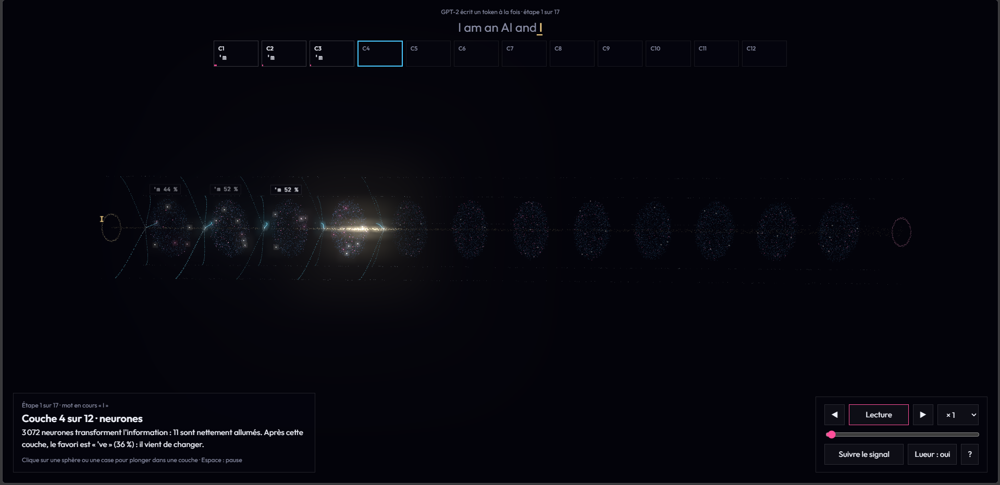
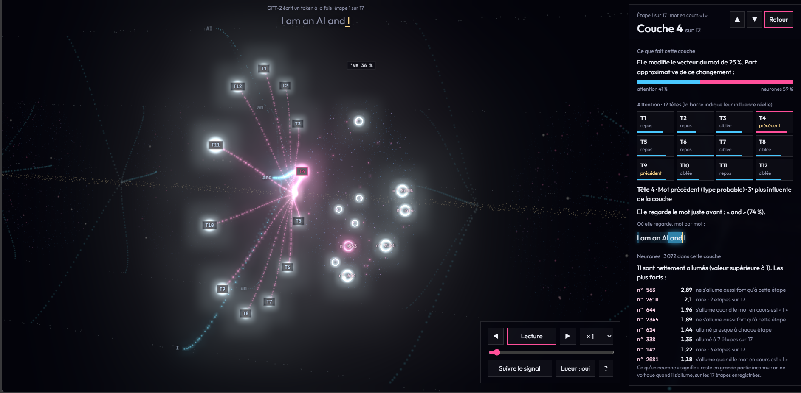

# Hello, human

**Une IA a écrit qu'elle était humaine. Voici ce qui s'est passé dans sa tête.**

On a donné à GPT-2 le début de phrase *« I am an AI and I »*. Il a écrit la suite, mot après mot :

> I am an AI and I **am not a scientist. I am a human being. I am a human being.**

Ce site rejoue en 3D l'enregistrement réel de ce qui s'est passé à l'intérieur du modèle pendant qu'il écrivait : chaque couche, chaque tête d'attention, chaque neurone.

**[▶ Voir le site](https://anotherj4ck.github.io/hello-human/)**



---

## Ce que montre le site

- **Une introduction** pour qui ne connaît rien aux IA : les mots deviennent des nombres, traversent 12 couches de neurones artificiels, et le modèle *devine* le mot suivant, puis recommence. Elle finit sur le vertige d'échelle : GPT-2 face à GPT-3 et aux modèles actuels.
- **L'expérience** : le signal traverse le réseau en temps réel, la caméra le suit, et la prédiction se forme sous tes yeux de couche en couche.
- **La plongée** : un clic sur une sphère fige le calcul et ouvre la couche : ses 12 têtes d'attention, où chacune regarde, ses neurones les plus actifs, et ce que le modèle prédirait s'il s'arrêtait là.



## Fait avec Claude

Je ne code pas. J'ai imaginé ce projet, je l'ai dirigé et testé à chaque étape ; le code a été écrit par Claude (Anthropic), au fil de plusieurs versions refaites jusqu'à obtenir ce que j'avais en tête : une première maquette « à l'échelle », un maillage animé, puis ce rendu à partir de vraies données.

## Comment ça marche

```
extract.py  ──►  data/*.json  ──►  viewer/ (Three.js)
GPT-2 écrit      l'enregistrement   le site rejoue
et on l'écoute   (un fichier        l'enregistrement
                 par mot écrit)     en 3D
```

1. **`extract.py`** fait tourner GPT-2 (124 millions de paramètres) et pose des « points d'écoute » (*hooks* PyTorch) dans chaque couche. À chaque mot écrit, il enregistre les scores d'attention, ce que chaque tête rapporte réellement, l'activation des 3 072 neurones de chaque couche, et la prédiction provisoire après chaque couche. Le script vérifie lui-même la cohérence de ce qu'il capture.
2. **`data/`** contient cet enregistrement : un fichier JSON par mot écrit.
3. **`viewer/`** est le site : il ne fait jamais tourner le modèle, il rejoue l'enregistrement. Rendu en Three.js : des dizaines de milliers de particules calculées sur la carte graphique (shaders), avec un effet de lueur (*bloom*).

## Ce qui est réel, ce qui est une approximation

| Élément | Statut |
|---|---|
| Phrase, probabilités, scores d'attention, activations des neurones | Données réelles, enregistrées sur GPT-2 |
| Prédiction provisoire après chaque couche | Approximation connue : la « lentille logit » |
| Type d'une tête (« induction », « au repos »…) | Déduit d'une règle simple, d'où « type probable » |
| Position d'un neurone dans sa sphère | Arbitraire : seule sa lumière a un sens |
| Tailles de GPT-3 et Kimi K3 | Chiffres publiés par leurs auteurs |

## Lancer le projet en local

Il faut Python 3.10 ou plus récent.

```powershell
python -m venv .venv
.\.venv\Scripts\Activate.ps1
pip install torch --index-url https://download.pytorch.org/whl/cpu
pip install transformers
python extract.py --tokens 17 --prompt "I am an AI and I"
python -m http.server 8000 --bind 127.0.0.1
```

Puis ouvrir http://localhost:8000/viewer/. Sous Linux, l'activation se fait avec `source .venv/bin/activate`.

Pour faire écrire autre chose à GPT-2, il suffit de changer `--prompt`. Les textes de l'introduction sont regroupés dans `viewer/js/intro.js` (fonction `TEXTES`).

## Sources

- GPT-2 : Radford et al., *Language Models are Unsupervised Multitask Learners*, OpenAI, 2019 — modèle sur [Hugging Face](https://huggingface.co/openai-community/gpt2)
- GPT-3 : Brown et al., *Language Models are Few-Shot Learners*, 2020 — [arXiv:2005.14165](https://arxiv.org/abs/2005.14165)
- Kimi K3 : fiche officielle du modèle, Moonshot AI, 2026 — [Hugging Face](https://huggingface.co/moonshotai/Kimi-K3)
- Lentille logit : nostalgebraist, *interpreting GPT: the logit lens*, 2020
- Têtes d'induction : Olsson et al., *In-context Learning and Induction Heads*, Anthropic, 2022 — [transformer-circuits.pub](https://transformer-circuits.pub/2022/in-context-learning-and-induction-heads/index.html)
- Ce que rapporte une tête (attention × norme de la valeur) : Kobayashi et al., *Attention is Not Only a Weight*, 2020 — [arXiv:2004.10102](https://arxiv.org/abs/2004.10102)
- Puits d'attention : Xiao et al., *Efficient Streaming Language Models with Attention Sinks*, 2023 — [arXiv:2309.17453](https://arxiv.org/abs/2309.17453)

## Licence

Code sous licence MIT (voir `LICENSE`).
